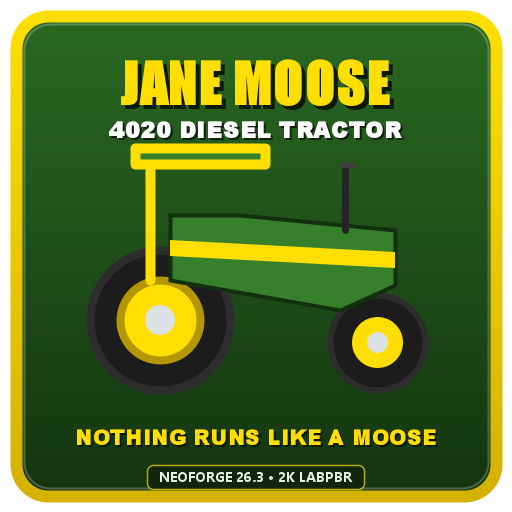

# 🚜 Jane Moose 4020 — Diesel Machinery Mod

<p align="center">
  
</p>

<p align="center">
  <em>"Nothing runs like a moose!"</em>
</p>

<p align="center">
  <a href="https://neoforged.net/"></a>
  <a href="https://neoforged.net/"></a>
  <a href="CHANGELOG.md"></a>
  <a href="LICENSE"></a>
</p>

---

## 📖 Overview

**Jane Moose** brings authentic, heavy-duty American agricultural power to Minecraft with the vintage **Jane Moose Model 4020 Diesel Tractor** and modular 3-point hitch implement attachments. Featuring real-life farming physics, realistic diesel fueling, interactive custom GUIs, 2K photorealistic textures, and full **LabPBR 1.3 Parallax Occlusion Mapping (POM)** shader compatibility!

---

## 🌾 Features & Mechanics

### 🚜 Jane Moose Model 4020 Tractor
- **Authentic 4020 Silhouette**: Modeled after iconic American agricultural iron — featuring 16-faceted round wheels, front suitcase counterweights, graphite exhaust smokestack with rain flapper cap, cyclone pre-cleaner dome, contoured operator seat, ROPS canopy sunshade, and authentic yellow-striped green livery.
- **Dynamic Torch-Level Headlights**: Real-world front illumination (Light Level 15) projecting a 15-block beam ahead of the tractor with adaptive slope, crop, and water avoidance (`LightBlock.WATERLOGGED`). Zero leftover phantom light blocks upon driving, unloading, or dismounting.
- **Realistic Driving Physics**: Responsive forward/reverse throttle, true turning radii, hill climbing, and anti-trample soil preservation so tractor tires never destroy tilled farmland.
- **Speed Governance**: Operates at 100% transport speed when traveling or unhitched; automatically throttled to 50% working speed when an implement is lowered and actively working.
- **Dual-Fuel Engine (Diesel & Ethanol Biofuel)**: Internal 10,000 mB fuel reservoir. Refuel via **Diesel Canisters**, **Ethanol Buckets** from the **Refinery** mod (`refinery:ethanol_bucket`), or any compatible fuel item (`#c:diesel`, `#c:fuels/diesel`, `#c:ethanol`, `#c:fuels/ethanol`). Creates a self-sustaining agricultural biofuel loop!
- **Interactive Dashboard GUI**: Press `[C]` or sneak-right-click to monitor fuel levels, rename your tractor, toggle hydraulics, engage the engine, and switch headlights On/Off.

### 🌾 3-Point Hitch Attachments & Tiers
Attachments can be placed directly in the world as 3D entities by right-clicking, then hitched to the tractor's rear drawbar by reversing up to them.

1. **Spring-Tooth Cultivator** *(Tills soil & grass into farmland)*:
   - **Wood Cultivator**: 1-block working swath.
   - **Iron Cultivator**: 2-block working swath.
   - **Diamond Cultivator**: 3-block working swath.
2. **Multi-Row Crop Planter** *(Sows seeds onto tilled farmland)*:
   - Equipped with parallel linkage, tapered poly seed hoppers, and press wheels.
   - Internal seed inventory (9, 18, or 27 slots depending on tier). Load Wheat, Carrot, Potato, Beetroot, or Pumpkin/Melon seeds to sow fields automatically.
3. **Combine Grain Harvester** *(Reaps crops, auto-replants, gathers grain)*:
   - Features rotating 4-bat pickup reel, double-knife sickle bar, and gathering auger.
   - Automatically cuts mature crops, replants the base crop, and routes the harvested yield into its internal grain tank.

---

## 🎮 Controls & Keybindings

All keybindings are fully rebindable in the standard Minecraft **Options > Controls > Key Binds** menu under the **Jane Moose Machinery** category:

| Action | Default Key | Context | Description |
| :--- | :---: | :---: | :--- |
| **Drive / Steer** | `W / A / S / D` | Riding | Throttle forward/reverse, steer left/right. |
| **Dismount** | `Left Shift` | Riding | Safely dismount the tractor. |
| **Toggle Headlights** | `[L]` | Riding / GUI | Turn high-beam torch headlights **ON / OFF**. |
| **Lift / Lower Hydraulics** | `[H]` or `Space` | Riding / GUI | Switch between **Transport Mode** (Raised) & **Working Mode** (Lowered). |
| **Toggle Implement Power** | `[X]` | Riding / GUI | Engage / disengage the PTO implement mechanism. |
| **Open Tractor Dashboard** | `[C]` | Riding / Stand | Access fuel status, rename box, and quick toggles. |
| **Place Implement** | `Right-Click` | Handheld | Deploy 3D implement entity into world. |
| **Hitch Implement** | Reverse near | Driving | Tractor auto-hitches when backing up to an implement. |
| **Unhitch Implement** | `Shift + Right-Click` | Outside | Detach hitched implement using an empty hand or wrench. |
| **Pack Up Tractor** | `Shift + Right-Click` | Outside (Wrench) | Retrieve tractor and attachments into inventory item form. |

---

## 🎨 Shaders & LabPBR POM Compatibility

Jane Moose is engineered to look stunning with and without shaders:
- **Vanilla**: High-contrast, clean 2K baked ambient occlusion textures.
- **Shaderpacks (Iris, Oculus, Complementary, SEUS, Kappa)**: Full **LabPBR 1.3** specification.
  - Tangent Normal & POM Height Maps (`_n.png`): Tire tread lugs, radiator honeycomb mesh, hood louvers, and diamond plate exhibit real 3D depth.
  - Decal Preservation: "JANE MOOSE 4020" lettering and stripe decals are clamped to pure height `255` and flat normal `(128, 128, 255)`, guaranteeing crisp, zero-stepping text under parallax raymarching.
  - Specular & Roughness Maps (`_s.png`): Distinct metallic reflections on chrome bezels, sheet metal paint gloss, and matte rubber tires.

---

## 📋 Changelog Summary

### [v1.0.2] - 2026-10-24
- **Fermentation Barrel Block**: 3D rounded oak barrel block with bulging bilge, iron hoops, and custom GUI.
- **Wheat-to-Ethanol Conversion**: Automatically ferments 1 Wheat into 1 Bucket (1,000 mB) of Ethanol per 1 real-life minute (1,200 ticks).
- **Ethanol Bucket Item**: Added `janemoose:ethanol_bucket` (+1,000 mB fuel, craftRemainder bucket) with `#c:ethanol` support.
- **Dual-Fuel Engine**: Tractor accepts both Diesel and Ethanol biofuel in-world and in the Dashboard GUI.

### [v1.0.1] - 2026-10-24
- **Dynamic Headlight Illumination**: Real-world torch light (Level 15) projected from front grille lenses ($1.85\text{m}$ forward, $Y+0.85$) with waterlogging and slope support.
- **Assignable Keybinding**: Added `[L]` hotkey under `Jane Moose Machinery` to toggle headlights.
- **Dashboard Headlight Button**: Integrated `Lights: ON / OFF` button on the tractor dashboard GUI.
- **POM Shader Text Fix**: Resolved text scrambling and distortion under Parallax Occlusion Mapping shaders.
- **Flicker-Free 3D Geometry**: Fixed Z-fighting on front grille, headlights, wheel rims, and rear chassis/hitch.
- **Handheld Placement Fix**: Cultivators and implements deploy as 3D entities on right-click instead of tilling dirt.
- **Crash Prevention**: Eliminated synthetic enum switch classes that caused `ZipException` / `ClassNotFoundException` when opening hopper inventories.

*For the complete historical log, see [CHANGELOG.md](CHANGELOG.md).*

---

## ⚙️ Building from Source

### Prerequisites
- **JDK 21** or newer (Eclipse Adoptium Temurin recommended)
- Internet connection for initial NeoForge artifact resolution

### Compilation
```bash
# Clone the repository
git clone https://github.com/Swack/janemoose.git
cd janemoose

# Build with Gradle
./gradlew build --no-daemon
```
The compiled mod JAR will be located in `build/libs/janemoose-1.0.0.jar`.

---

## 📜 License & Modpack Permissions

This project is licensed under the **MIT License** — see the [LICENSE](LICENSE) file for details.  
You are completely free to include **Jane Moose** in any public or private modpack!
